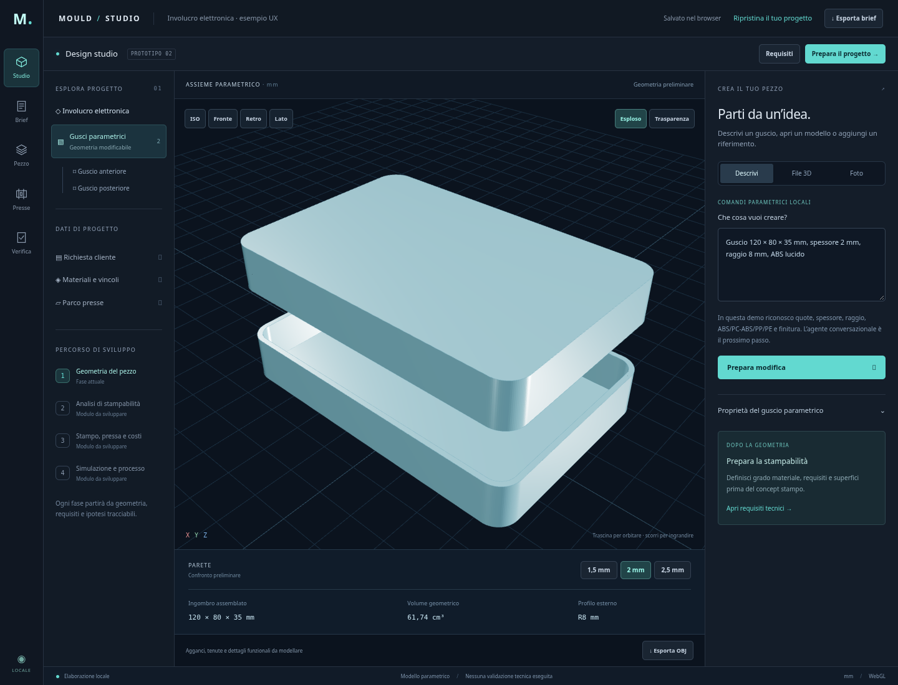

# Mould Studio · Demo 02

1. [Scarica il pacchetto ZIP](progettazione-stampi-demo.zip?raw=true).
2. Estrai il contenuto sul computer.
3. Apri **Progettazione-stampi.html** con Chrome, Edge, Firefox o Safari aggiornati.

Non occorrono installazioni o connessione Internet. Si apre il nuovo workspace CAD, con modello centrale, albero del progetto e pannello di creazione.

- **Descrivi:** prova “Guscio 140 × 90 × 40 mm, spessore 2 mm, raggio 10 mm, PP lucido”. Prepara la modifica, controlla i parametri e applicala al guscio. Puoi annullare l'ultima modifica. Sono comandi locali per la famiglia di gusci della demo; l'agente AI conversazionale sarà un modulo successivo.
- **File 3D:** scegli le unità e carica una mesh OBJ/STL (massimo 12 MB e 100.000 triangoli). Puoi ruotarla e consultarne gli ingombri. Questi passano al brief solo premendo “Usa questi ingombri nel brief”. STEP è previsto con il motore CAD.
- **Foto:** carica JPG/PNG/WebP come riferimento visivo. La ricostruzione automatica non è ancora implementata. Per dimensionarla serviranno misure note e più viste.

Puoi sempre esplorare i gusci parametrici, confrontare gli spessori, compilare il brief, registrare presse ed esportare JSON/OBJ. Il percorso successivo è indicato nell'albero: stampabilità, stampo/pressa/costi, simulazione.

Il visualizzatore richiede WebGL2. I dati rimangono nel browser; usa l'export per conservarne una copia. La persistenza dei file locali dipende dal browser e dalla posizione del file. Mesh e foto rimangono in memoria solo per questa sessione: dopo un riavvio vanno ricaricate. Il JSON contiene i loro metadati, non i file.

Questa versione mostra l'interfaccia e il pezzo parametrico semplificato. Stampo, agganci, tenute e schede non sono ancora modellati; simulazioni fisiche, import STEP, agenti AI, costi e PCA/PLS sono sviluppi successivi. IP65 e 1.000 cicli sono requisiti da verificare.
