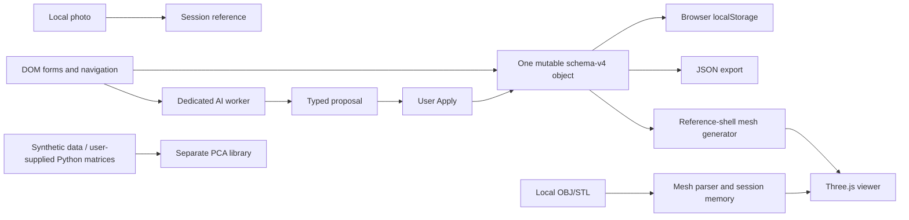

# Current-state audit

Audit `AUD-2026-10-17`, 17 October 2026. Examined branch: `demo/progettazione-stampi-2026-10-15`, commit `0fe5efe3e626edf7c93138efa83be821bfcea8a0`. The working tree was clean before the audit. This report describes that baseline; the audit adds documentation and reproducibility helpers, not application features. Nothing is pushed, merged or published by this increment.

## Finding

There are two useful but disconnected implementations: a browser requirements/geometry/AI demo and a Python PCA library. There is no integrated engineering platform, backend application, persistent project service, mould generator, process simulator or economic engine. Reuse the existing engines and tests while separating their responsibilities; a wholesale rewrite would discard working behaviour without resolving the missing domain model.

## Evidence and implemented behaviour

| Area | Source evidence | What actually works | Boundary |
| --- | --- | --- | --- |
| Project data | `prototype/app.js`: `newProject`, `normalizeStoredProject`, `save`, `exportProject` | One active browser project, commercial/technical fields, press records, migration v1–v4, backup/restore of the example, JSON export | New projects contain shell/PCB/IP65 requirements and a five-year programme; no generic project list, server storage or JSON import |
| Geometry | `prototype/shell-geometry.js` | Three supported shell configurations, rounded outlines, wall candidates, oriented triangle meshes, geometric volume, OBJ export | Procedural mesh templates, not a B-rep CAD kernel; no STEP, feature graph, assemblies, moulds or manufacturing details |
| Imported geometry | `prototype/mesh-import.js`, app file handler | OBJ/STL with declared units, bounds and local display; explicit adoption of bounds | No watertight-solid certification, inferred volume/material or retained original file after restart; mesh is recentered and source offset is not retained as a reusable frame transform |
| Reference photos | App file handler | Local PNG/JPEG/WebP display with byte/pixel limits | Reference only; no metric reconstruction or image-to-CAD model |
| Viewer | `prototype/concept-view.js`, `workspace.js`, `cad-ui.js` | Three.js/WebGL2 orbit/zoom/pan, standard views, fit, grid, wireframe, transparency and display explosion | No object picking/selection API, sections, operational assembly hierarchy, process clock or result fields |
| Navigation | App `render` and `refreshConcept` | Brief, product, studio, presses and review views | `render` disposes the renderer and replaces content; the 3D viewport and copilot are not persistent across modules. Panels are not generally collapsible/resizable |
| Browser AI | `ai-worker.js`, `ai-client.js`, `ai-contract.js`, `ai-apply.js` | Actual Qwen text generation; conversation and structured-change modes; allowlisted fields, preview/apply, geometric consistency check, source metadata and stale-timestamp rejection | Narrow smoke coverage; no application tool registry, identity/permissions, multi-operation execution, server revisions or AI undo. Displayed advice is not engineering evidence |
| Local commands | `description.js`, app `applyDescription` | Deterministic dimensional/material commands with review/apply and one undo snapshot | Separate from AI; not arbitrary product modelling |
| Python analytics | `pca_monitor/nipals.py`, `preprocessing.py`, `diagnostics.py`, `plots.py` | NIPALS PCA, scaling, batch unfolding/imputation, monitoring and plotting APIs | Disconnected from browser; correctness defects below; no PLS implementation or validated optimisation |
| Legacy cloud AI | `pca_monitor/ai_interpreter.py` | Optional Gemini/Claude client wrappers in library code | External inference services and credentials; not the browser AI and not an acceptable essential dependency for the new self-hosted workflow. No provider calls made in this audit |
| Delivery | Build/package scripts; `demo/` | Single-file HTML, local preview and ZIP; runtime licences embedded | No public hosted service, authenticated projects, worker service, backup restoration service or deployment pipeline |

The official source/documentation language is English; historical Python comments/docstrings remain partly Italian. The browser already supports EN/IT/FR/ES with English default. Preserve those translations rather than reducing them to EN/IT.

## Runtime/data flow

No arrow connects PCA to the browser or a process simulator. The browser worker downloads version-pinned runtime/model assets; it does not POST prompts to an inference API. Model hosting still sees ordinary asset requests. Conversation and source files are session-only; accepted values are stored in browser data. The PCA interpreter is a different, optionally external, data path.

## Reverification on 17 October

| Check | Observed result | Interpretation |
| --- | --- | --- |
| `npm test` in `prototype` | 28 passed | Geometry, units/import, command parser, i18n and AI contract/state software checks; not scientific validation |
| `npm run test:browser` | Passed | Real WebGL and user workflows in isolated Chromium |
| `npm run build:standalone` + `cmp` against tracked HTML | Passed; identical bytes | Source reproduces the delivered baseline HTML |
| `npm run test:standalone` | Passed | Core workflows over loopback with networking disconnected during interaction |
| `npm run test:ai-local` | Passed | Actual bundled worker, pinned Qwen/q4, one-thread WASM; reviewed demand/market change persists; ordinary conversation leaves data unchanged |
| Python `pip check` | Passed | Installed dependency consistency only |
| PCA/SVD reproduction | Defects reproduced | See numerical findings; a passing reproduction means the defect was observed, not fixed |
| `npm audit --json` | Exit 1: six affected dependency entries, two high/four moderate | Includes inherited reports; requires reachability/remediation review, not six proven independent exploits |

The AI run uses locally hosted copies of the actual pinned assets, not mocked responses. Remote-host browser downloads previously failed due to Chromium's cloud proxy trust store; that route is not reclassified as passed. `file://` opening is not directly verified because of the managed browser policy. No new remote-model test was required to establish the already diagnosed limitation. Heavy solver/kernel installation, penetration testing, real-data validation, Python CVE scanning and multiuser/tenant acceptance were not performed.

## Prioritised findings

| ID | Finding | Consequence and action |
| --- | --- | --- |
| ARC-01 | Global shell/electronics defaults and single active project | Introduce a generic, versioned domain model and explicit example templates before adding mould modules |
| ARC-02 | Data, rendering, persistence, fields and navigation share `app.js` | Extract application operations/repositories; keep the existing viewer adapter and geometry utilities |
| ARC-03 | Viewer disposal on module switch; no shared selection/scene | Add one persistent scene owner, independent panels and stable object IDs; preserve camera state |
| ARC-04 | Timestamp-based proposal check, no durable revision ledger/AI undo | Use server-issued integer revisions, atomic operation records and compensating revisions; approval must bind exact effects |
| AI-01 | Typed schema cannot establish that an allowed value is grounded; per-value source omits exact model revision/request evidence | Preserve explicit review and add source spans, model/input hashes and operation audit records; do not auto-execute plausible fabricated values |
| ARC-05 | Kit/assembly selector exists but demand/cost labels still use parts and no BOM | Explicit commercial-unit quantities and unit conversions are needed before capacity/cost comparison |
| SCI-01 | PCA stores score sums of squares as eigenvalues and uses them directly for T²/Q limits | Wrong statistical scale; block recommendations pending correction/reference tests |
| SCI-02 | Q limit only sees fitted components; fabricates a small residual when spectrum is absent | Compute/document an appropriate residual spectrum or refuse the limit; no silent fallback |
| SCI-03 | An all-missing sample returns T²=Q=0 and no anomaly flag | Report insufficient data, not a healthy process |
| SCI-04 | RMSECV is held-out-row reconstruction using all observed variables | Do not treat its minimum as independently validated latent dimension selection or predictive PLS evidence |
| SEC-01 | Current native ML dependency graph has reported advisories | Triage `sharp`/libvips and `sprintf-js` chains before exposing native processing; do not run an automatic upgrade during the audit |
| SEC-02 | No authentication, project ACLs, compute isolation or server quotas | Remain a controlled local demo; these are release requirements, not completed controls |
| SEC-03 | Mesh triangle limits are checked after loader parsing | Main-thread parse/memory stress remains possible within byte limits; move untrusted parsing to bounded workers |
| LEG-01 | MIT file is present, but two Git author labels do not establish ownership | Preserve MIT; confirm rights/contributions before proposing any relicense |
| LEG-02 | Native optional dependencies include LGPL-3.0-or-later libvips packages | Package/container review must include native notices and distribution obligations |
| LEG-03 | Upstream Qwen licence is known; conversion provenance needs separate distribution review | Do not describe all AI artefacts as fully open source or automatically cleared for redistribution |
| DATA-01 | Requested public records blocked by egress proxy | Record author/DOI/licence/availability as unverified; import none; retain D's requested embargo exclusion |
| UX-01 | Existing light CAD-style experiment does not meet the new original/persistent dark workspace | Implement the selected original design after the domain/operation foundation, not as another standalone mock feature |

## Numerical evidence

On repository-generated synthetic data (seed 42; 300 calibration rows, six fitted PCs, two retained):

- Current maximum T²: `0.033147`; covariance-normalised SVD reference: `9.910960`. The scale ratio is approximately `n−1 = 299`; current T² limit is `6.092652`.
- Current Q limit: `1036.096643`; maximum observed Q: `13.060296`. Dividing that full-spectrum limit by 299 gives `3.465206`, a diagnostic comparison rather than a deployed correction.
- Current monitoring flags **0/11** injected thermal-spike observations. The normalised Q comparison flags **11/11**. This is a synthetic example, not a measured industrial sensitivity estimate.
- Fitting only two PCs produces Q limit `0.0000037468` using the invented residual fallback.
- A wholly missing row produces `T²=0`, `Q=0`, `anomaly_any=false`.

The SVD residual comparison differs by about `1.06e-5`; the normalised T² comparison differs by `7.60e-6`. These observations localise the issue without silently changing production code. Reproduce with [the audit helper](../verification/scripts/reproduce_pca_findings.py); see [validation protocols](../data/VALIDATION_PROTOCOL.md).

## Reuse decisions

Keep Three.js, mesh/command/shell modules, translations, existing boundary tests, AI worker/client separation and strict proposal validation. Put them behind generic scene, asset, operation and inference interfaces. Preserve legacy imports as explicitly marked examples with per-product properties and their original files/frames. Reuse Python analytics only after correctness work. No numerical or proprietary-provider functionality is required to create generic customer projects.

Next: [target architecture](TARGET_ARCHITECTURE.md), [implementation plan](../planning/IMPLEMENTATION_PLAN.md), [legal review](../compliance/LEGAL_AND_LICENSE_AUDIT.md), [threat model](../security/THREAT_MODEL.md).
