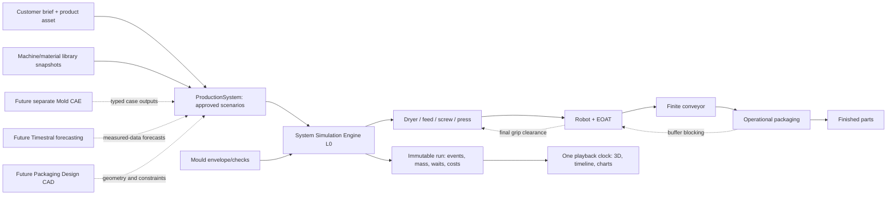

# System Simulation Engine — implemented L0 contract

The root `production_system` field belongs to the project. `server/app/system/{schemas,domain,engine,service}.py` separates typed inputs, dependency/provenance graph, pure deterministic scheduling and transactional storage/API orchestration. The existing `engineering` root field and `configured-l0/1` engine remain compatibility subsystems; they do not own new system scenarios. No new microservice, broker or numerical dependency is added.

## Data and causality

`ProductionSystem` has a stable UUID, schema version and up to 20 scenarios. Each scenario has a stable ID and monotonic revision, typed `recipe`, `mould`, `robot`, `conveyor`, `packaging`, `costs`, a source/origin, policy and selected machine/material IDs. Selected library records and asset metadata are frozen on approval. Source bytes remain project-owned immutable assets. Changing geometry requires an approved scenario rebind; historical runs remain downloadable.

`domain.graph()` exposes ten nodes and typed material/part ports, units, extraction/cell frame and `simulation_seconds` time basis. Mass → part conversion occurs inside the mould subsystem using declared part/runner mass, not by connecting unlike ports. Each numeric/unknown input has path, value, unit, source, model version, scenario revision and validity metadata. Run manifests identify **fabrivra.system-l0/1**, L0, MIT and lack of independent production validation. This graph documents the implemented fixed topology; it is not a generic arbitrary graph/FMI co-simulation runtime.

## Deterministic event algorithm

The engine is an original standard-library resource-reservation scheduler: causally monotonic robot deposits feed a FIFO single-operator packaging service. A min-heap of downstream pickup times releases finite conveyor slots. Virtual time advances by resource availability, not wall-clock sleeps or simulation timesteps.

- Dose `g = cavities × part_mass_g + runner_mass_g`. Available whole shots are limited by initial stock and the configured hopper reservation.
- Batch conditioning releases configured stock at its completion. Feeder transport is `delay_s + dose_g / feed_rate_g_s`. These are configured delays, not material drying/transport physics.
- Plasticising for the next shot can overlap cooling after holding finishes, subject to feed, hopper and screw reservations. Press closing may overlap preparation but injection waits for its complete dose.
- Injection time is at least `dose_g × 1000 / melt_density_kg_m3 / max_injection_rate_cm3_s`, if both declared values are known. Plasticising time is at least `dose_g / plasticising_capacity_g_s`. These capacity bounds are dimensional checks, not pressure/rheology/quality solutions.
- Closing/injection/holding/cooling/opening/ejection reserve the press. The next closing cannot start before the *last* EOAT grip clears the current mould. Multiple trips include configured return/reindex time.
- Each deposit needs all of its finite conveyor slots simultaneously, plus configured batch pitch. A slot remains occupied during travel and downstream waiting until packaging pickup. Full capacity blocks the loaded robot, which can then delay later press unloading.
- Packaging pickup removes one part from the conveyor. Handling completes it. A full container reserves the single packaging operator for its configured change time; no change is charged after the campaign's final output. Finite container supply is preflight-checked: insufficient supply blocks the campaign conservatively rather than inventing unlimited boxes or a deadlock completion time.
- Mass is transferred at explicitly recorded event completion times across raw, conditioned, hopper, melt, mould, robot, belt, packaging, output and runner bins. No continuous field is inferred. The engine refuses to save a result failing final conservation/non-negativity; tests independently check *every* event boundary and resource overlap.

Throughput is `finished_count × 3600 / complete_campaign_duration`, including startup/drain. The injection-interval rate is separate. Busy-time ranking is explicitly a **heuristic**, not a proven unique bottleneck; downstream interventions independently demonstrate causality. A different material/pressure/quality model could change configured timings/acceptance, but none is silently assumed.

**Implemented numerical evidence is software verification**, including a hand-calculated single-shot oracle, conservation, independent resource/buffer invariants and targeted equipment interventions. It is not an experimentally validated material/production model. General discrete-event scheduling and `F=pA`, density/volume/rate identities are the algorithmic basis; no inaccessible paper or community certification is claimed as validation.

## Constraints and economics

Necessary clamp/shot/tie-bar/mould-height/daylight/opening checks reuse `engineering.py` with frozen configuration. Unknowns stay incomplete; failures block. EOAT slots/mass/pitch and *declared* travel checks are typed. XYZ-only orientation mismatch fails. Geometric swept-volume, collision and actual EOAT/container fit are always unknown in this increment; a declared reach inequality cannot pass a geometric check. Exploratory policy permits unknown critical inputs while displaying them; strict policy requires known critical L0 constraints.

Campaign costing uses decimal strings for money and `Decimal` calculations: declared press/robot/packaging hourly rates times elapsed campaign hours (including waiting), consumed feed including runner waste, used containers and tooling investment allocated across declared programme demand. Energy is either already included or explicitly added once per shot; unknown additional energy prices prevent a complete price if needed. Annual output projection uses configured hours and repeated finite-campaign rate, assumes 100% acceptance, and supplies no OEE/scrap/market forecast. Prices/targets are not generated by AI. Finite alternatives expose non-dominated cost/throughput points; this is not a global optimiser.

## Transactions, invalidation and portability

Configuration proposals use the existing preview → digest-bound approval → execute → append revision ledger. Manual and AI proposals share the same tool. Undo appends a compensating project revision and a new scenario revision; it cannot overwrite intervening changes or resurrect an old approval. Compare freezes inputs, computes results, then checks the project revision again inside the insertion transaction. New `system_runs` is additive; legacy tables/data are not replaced.

| Change | Relevant invalidation |
|---|---|
| Product bytes/units, cavity layout | Geometry/layout, press/EOAT checks, animation; geometry rebind required before rerun |
| Machine physical capacities | Press checks, schedule, animation, economics |
| EOAT/robot pose or capacity | EOAT checks, schedule, animation, economics |
| Belt, buffer, container or handling time | Schedule, animation, economics; no unnecessary mould re-mesh/press-size invalidation |
| Hourly/material/tool costs only | Economics; physical schedule hash stays valid |
| Scenario display name only | No physical/economic dependency change |

Hashes identify dependencies/staleness. All comparison reruns currently recompute the lightweight L0 schedule; no persistent result cache or incremental CAE recomputation is claimed. Existing run snapshots remain immutable and project-scoped.

Portable backup format `fabrivra.project-backup/1` is an owner-project JSON archive with geometry bytes/hashes, state, all revisions, referenced resources and saved runs, excluding security credentials/session/approval tables. Its SHA-256 uses typed JSON semantic canonicalisation: numeric values normalise through IEEE754 so a browser's `200.0 → 200` rewrite preserves integrity; exact money strings keep their distinct representation. All types are tagged to avoid number/string/array aliasing. This is an application checksum, **not RFC 8785 certification, a signature or proof of source authenticity**. Restore validates bounds/contracts/manifests, uses fresh IDs and a transaction, retains archive provenance and never replaces an existing project. Pending approvals/old undo tokens are not restored. Full workspace SQLite backups are private, verified and separately cover all tables.

## Specialist adapters

`CAEOutput` defines solver/version, geometry identity, convergence/validation and optional cooling/pressure constraints. Non-converged results cannot claim a usable/validated output. `ForecastOutput` defines aligned finite timestamps, median/lower/upper bands, units/time basis and model/data identity; invalid intervals are rejected. These are **contracts only**: no solver ingestion orchestration, mesh, inference weights, Timestral download, forecasting or FMI runtime is installed. Packaging Design remains separate; its future geometry must supply constraints to the already implemented operational service.
