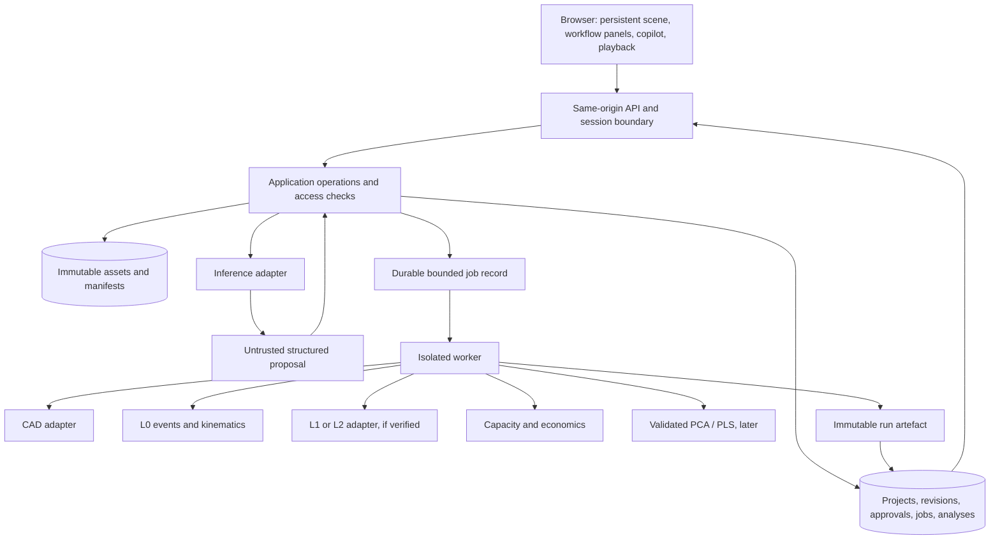

> **FABRIVRA V2, 26 October 2026:** the owner-supplied V2 package supersedes earlier product/deployment assumptions. The core is the complete **System Simulation Engine**; Mold CAE, Timestral and Packaging Design are separate modules. [Active contract/roadmap](../product/FABRIVRA_V2.md) · [Current browser trial](../deployment/CODESPACES.md). The dated text below is retained history.

# Target architecture and decision record

Audit baseline `AUD-2026-10-17`. **Proposed implementation**, not a list of running services. This document supersedes conflicting stack/workflow assumptions in the earlier architecture sketch. The agreed product path remains customer request → product → mould → press/cell → process → economics → optimisation.

## Decisions

1. Build a modular monolith with a separate job worker, not independent microservices for every module. Share a typed domain/operation contract; separate long-running or unsafe file processing at process boundaries.
2. Keep the Three.js engine and tested geometric/import modules. Establish a scene adapter before incrementally introducing a React/TypeScript application shell. Avoid a simultaneous rewrite of geometry, persistence and interface.
3. Use a Python API/domain layer (FastAPI/Pydantic candidates), SQLAlchemy-style transactional persistence and migrations. SQLite is acceptable for single-user local development; PostgreSQL must pass the same contract/concurrency tests before online/private use. These dependencies are **not yet adopted or installed in the application**; I01 includes pinning/install/API checks.
4. Store immutable assets by content digest on a persistent filesystem initially. Use project-scoped metadata/access checks, not public filesystem paths. Object storage is an adapter introduced only when needed.
5. Start durable jobs in the relational store with leases/idempotency and a separate bounded worker. Defer an extra broker; compare RQ/Valkey only if measured throughput requires it. Discrete-event simulation uses virtual time, not queue polling time.
6. Treat AI inference as replaceable. Keep browser Qwen as an optional local demo adapter. Evaluate self-hosted CPU/GPU inference independently; an open-weight licence is not proof of full open-source model provenance. No Gemini/Claude service is essential.
7. L0 engines produce event/state data; a browser playback clock samples that data. L1/L2 are separate, explicitly validated capabilities. Never generate a field by colouring the model when no solver result exists.
8. Retain MIT during this work. No new licence, paid provider, hosting spend or irreversible deployment decision is authorised by this architecture proposal.

## Boundaries

Workers have no ambient access to other project assets, infrastructure credentials or arbitrary internet destinations. Model text, uploaded documents, CAD attributes and scientific metadata are untrusted input. The AI cannot run shell commands, Python snippets, arbitrary paths or generated code.

## Domain model

| Aggregate | Required content |
| --- | --- |
| Project | ID, schema version, title, currency, memberships, head revision, data policy and source records; no product-specific defaults |
| Commercial brief | Enquiry, market, commercial unit and BOM, annual scenarios, programme length, prices/targets/budgets, production calendar, assumptions |
| Product variant | Stable product/variant/feature IDs, functional requirements, material grade reference, geometry/asset revisions and coordinate frame |
| Asset | Project owner, original file hash/format/size, explicit source units/frame, scan/parse state, derived preview hashes, licence/provenance and retention |
| Mould alternative | Products/cavities and individual rigid transforms, envelope/mounting/ejection references, feed/cooling/actuator configuration and fidelity |
| Cell | Press, mould, robot, end effector, belt and auxiliaries; actual axes, limits, installation transforms, capabilities and rate inclusions |
| Recipe/scenario | Parameter quantities, event dependencies/resources, initial conditions/inventories, horizon and fidelity per phenomenon |
| Run | Immutable input revision/hash, engine/version/configuration, event log, object/part state, signals with units, checks/limitations and completion state |
| Economic analysis | Run/input references, output by article/commercial unit, rates and their inclusions, cost basis, amortisation, missing/stale state |
| Dataset/model | Original data hashes, verified rights, measured/simulated/synthetic category, variables/units, split strategy, preprocessing/model versions and validity |
| Operation/approval | Principal/project/target, base revision, exact typed effects, provenance, digest, approval state, idempotency key, inverse/compensation and invalidations |

A quantity carries a value, unit, physical meaning and source; unknown is not zero. Engine boundaries convert to declared SI units while retaining original values. `mm`, `m`, `kN`, `Pa`, `cm³`, mass and temperature scales are checked. Currency, price basis and good commercial units are explicit. A kit/assembly is not interchangeable with an individual cavity output.

Legacy v4 is an import format only. Map shell/PCB/IP requirements to the imported product, preserve sources and flag example data. Never seed those values into a new generic project. Original mesh offsets/transforms and bytes must be preserved even when preview meshes are recentered.

## Authorised operations

The canonical future tool names are:

| Tool | Initial boundary | Status |
| --- | --- | --- |
| `update_commercial_requirements` | Explicit brief fields/quantities and source statement | First tool in I01; existing browser field proposal is reusable, not this server contract |
| `create_product_variant` | Versioned product/feature changes | Planned |
| `generate_parametric_geometry` | Declared template/feature operations, never executable source | Planned; restricted shell helper exists |
| `configure_mould`, `set_cavity_count` | Defined mould family, products and geometric constraints | Planned |
| `select_compatible_press` | Declared checks and missing input report | Planned |
| `configure_robot` | Real axes, limits, tool and installation frames | Planned |
| `run_process_simulation` | Authorised scenario/revision, bounded horizon/events and engine | Planned |
| `compare_total_cost` | Sourced quantities/rates plus actual run or explicit analytic estimate | Planned |
| `generate_engineering_report` | Versioned evidence, checks and limitations | Planned |

Every tool implements: validate → authorise → preview → bind approval → execute → record revision/results. Chat and properties call the same operation service. Model-origin fields such as project ID, permissions, price confidence or validation status are never trusted as authority.

An operation envelope contains `operation_id`, `project_id`, `base_revision`, `tool`, `targets`, `arguments`, `source_refs` and `idempotency_key`. Identity comes from the session, not this envelope. The server canonicalises effects and returns their digest, missing inputs, unavailable/performed checks, affected objects and stale results. Approval is single-use, principal/project/revision-bound, expires explicitly and covers that exact digest. Any changed effects require a fresh preview/approval.

Execution uses an optimistic compare-and-swap transaction. Repeating a successful idempotency key returns the existing result. Undo appends a compensating revision, preserving history; it cannot silently erase a later edit. A cascade such as 2→4 cavities creates a plan of dependent tool calls and jobs. Preview configuration changes plus invalidated compatibility/timing/cost results; do not display recomputed results until the corresponding engines complete.

## Assets, jobs and state integrity

Uploads first enter quarantine. Validate bytes/type/format without invoking privileged parsers, then process in a CPU/memory/time-bounded worker. Preserve the original asset, explicit units and parse diagnostics. CAD/mesh/document parsing receives no unrestricted network access or executable expressions. Jobs reference hashes, not client file paths.

Job states: queued, running, cancellation-requested, cancelled, succeeded, failed; partial artefacts remain labelled partial. A lease/heartbeat recovers abandoned work. A worker writes immutable output then atomically links its manifest. Retries do not create duplicate runs. A run on an old input revision is preserved as historical/stale, never silently applied to the current scenario.

## Persistent workspace and scene contract

One scene owner survives module changes. Panels subscribe to domain state and selected object IDs; they do not instantiate a viewer per route. `SceneAdapter` exposes mount/dispose, upsert/remove object by ID, selection, camera, clipping/display state, and `sampleRun(runId, t)`. Disposal occurs on project close/application teardown. Preview explosion transforms are kept separate from physical transforms.

A scene object records parent frame, local rigid transform, geometry revision, semantic role and source ID. Product/mould/cell simplifications state their fidelity. Selected geometry and the current revision are supplied to the copilot through authorised context assembly, not by serialising every private asset.

The original dark workspace and two evaluated variants are in [ORIGINAL_UI_SPEC.md](../design/ORIGINAL_UI_SPEC.md). Forms remain contextual; customer requirements can be edited while the central model remains visible or shows an honest empty project state.

## Simulation and economic contracts

An L0 result contains deterministic events `{time_s, sequence, resource, action, object_refs, state_delta}`, initial state, part identities and support transfers. Tie-breaking for equal timestamps is documented; all players/charts use the same virtual time. Resources, qualified inventory and dependency completion determine execution. Playback speed never changes results.

At handoff, preserve global pose using `T_new_local = inverse(T_new_support_world) × T_part_world`. An XYZ-only robot cannot rotate a part; an incompatible deposit orientation is a failed check requiring an explicit configured rotary device or changed layout. Use analytic motion profiles or sourced durations; sampled envelope tests are not certified continuous collision checks.

Press checks are independent, three-state results: passed for the performed preliminary check, failed, or incomplete. Require relevant shot requirements, material basis, clamp requirement, mounting/envelope constraints and strokes. Mesh bounds are not projected clamping area or shot volume. Explicitly supplied cavity pressure and projected area may support `F = pressure × area × declared factor`; hydraulic pressure is not substituted.

Capacity is reported by article and sold unit using actual events or an explicitly separate steady-state calculation. Track runners/rejects/energy/rate inclusions so they are counted once. If a rate already includes energy/depreciation, do not add them again. Missing mould cost or programme demand prevents an amortised total, not every unrelated analysis.

## Engine candidates and adoption gates

| Candidate | Role and limits | Audit decision |
| --- | --- | --- |
| NumPy/SciPy | Arrays, reduced balances, optimisation/numerical references | Installed numerical runtime; PCA audit/reference executed. No polymer model validated |
| SimPy | Discrete-event resources and waiting; not plasticisation/filling physics | MIT metadata verified; installation/API/performance/reference spike required before adoption |
| Open CASCADE + CadQuery/build123d | STEP/B-rep and supported parametric features | Inspect licences including OCCT exception; benchmark both wrappers on the same parts, select one. No kernel installed/tested here |
| CoolProp | Coolant/fluid properties where its fluids/domain apply | MIT metadata verified; not a polymer-grade PVT/rheology database |
| PyBullet | Candidate collision/kinematic support | zlib metadata verified; real axes and frames still belong to our domain. Dynamics is not evidence of safe robot operation |
| OpenFOAM / Elmer | Optional later CFD/FEM jobs | GPL / mixed GPL-LGPL scope needs component review, reproducible install and known benchmarks; not a turnkey injection solver |
| pymoo / Pyomo | Constrained search / algebraic optimisation | Candidate metadata checked. Pyomo also requires a suitable solver; neither supplies missing physical validity |
| scikit-learn | Future PLS and reference statistical models | Candidate; datasets, grouped validation and verified preprocessing required |
| llama.cpp / vLLM or browser runtime | Replaceable local/self-hosted inference | Capability, licence, hardware and model evaluation required independently; do not select a service from weights alone |

For each new engine, record exact version/hash, licence scope, clean installation, representative execution/API contract, analytical or experimental reference and justified tolerances, performance/memory, timeout/cancellation and domain limits. Until every relevant gate passes it remains a candidate. A licence/metadata read is not an execution test. No injection-specific open solver has been verified in this audit.

## Security, deployment and migration

The private online target uses HTTPS, authenticated sessions, project memberships and server-side authorisation before asset/job access. Prefer standards-based self-hostable OIDC over custom identity design; validate the chosen implementation before adoption. Use HttpOnly/Secure/SameSite cookies with CSRF/origin controls for state changes. Never accept arbitrary project identities from client headers.

An account-free public demo can remain a browser-only synthetic sandbox without private API/compute access. Single-user unauthenticated development, if used temporarily, must be explicitly loopback-only and must fail closed for public binding. Multiuser/private release is gated by identity/isolation tests, bounded jobs, backups and independent review. [THREAT_MODEL.md](../security/THREAT_MODEL.md) defines the controls and remaining gaps.

Migration sequence: generic domain/repository and operation boundary → durable brief/source assets → persistent scene/module shell → restricted mould/press checks → L0 events/playback → capacity/costs → CAD/kernel families and L1 → verified real-data analysis/L2 when justified. The first integrated L0 demonstration has a bounded supported family and explicit configured inputs; it is not arbitrary mould design. See [IMPLEMENTATION_PLAN.md](../planning/IMPLEMENTATION_PLAN.md) for files, tests and exit criteria.
