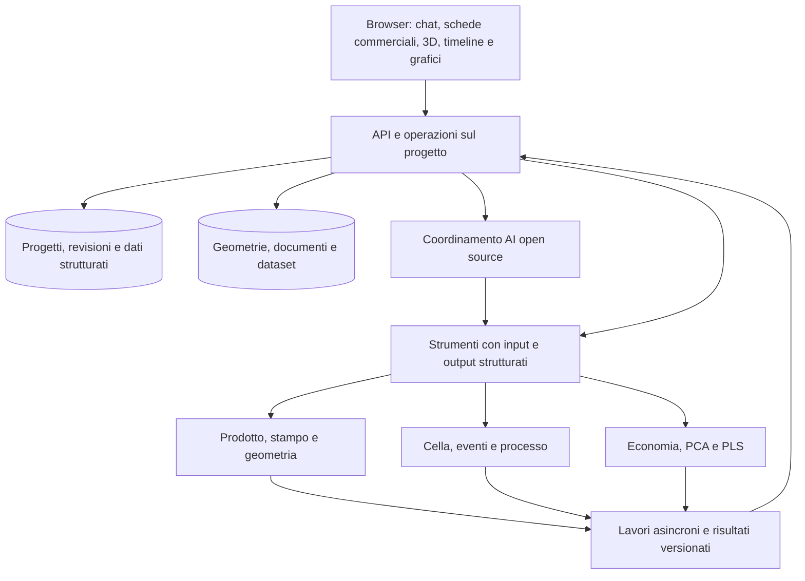

# Architettura della piattaforma online — revisione 3

Proposta tecnica del 2026-10-15, guidata dalla [specifica funzionale](SPECIFICATION.md). I componenti descritti qui sono da implementare; lo stato reale è in [IMPLEMENTATION_STATUS.md](IMPLEMENTATION_STATUS.md).

## Struttura

La chat e le proprietà usano le stesse operazioni applicative. I motori leggono uno snapshot di progetto; il browser riproduce eventi e risultati con lo stesso riferimento temporale. L'AI interpreta, propone, seleziona strumenti e spiega esiti; geometria e risultati numerici provengono dai motori dichiarati.

## Componenti open source proposti

| Componente | Proposta di partenza | Confine |
| --- | --- | --- |
| Applicazione web | React e TypeScript; Three.js per la scena | Esperienza principale cliente/processo; geometria e proprietà contestuali |
| API e validazione | Python, FastAPI e Pydantic | Dati generici, operazioni, revisioni, cataloghi e risultati |
| Persistenza | PostgreSQL e archivio file persistente con metadati; object storage compatibile quando necessario | Brief, conversazioni, geometrie originali, anteprime e dataset |
| Lavori lunghi | Worker Python e coda; RQ/Valkey come candidato da verificare | Import CAD, generazione, analisi, simulazioni e addestramento |
| Geometria | Open CASCADE, con CadQuery/FreeCAD o integrazione dedicata da valutare sul workflow | Solidi STEP, operazioni supportate, misure e concept; mesh distinta dal CAD |
| Simulazione | SimPy come candidato per eventi; NumPy/SciPy per modelli ridotti | Stato globale, risorse, bilanci e equazioni di processo |
| Dati e ML | NumPy, SciPy, scikit-learn e adattamento della libreria PCA esistente | PCA/PLS, preprocessing, validazione e ottimizzazione vincolata |
| Inferenza AI | Servizio con modelli selezionati per licenza e capacità; llama.cpp o vLLM secondo hardware | Testo, documenti e visione; nessun servizio proprietario obbligatorio |
| Distribuzione | Container, reverse proxy HTTPS, database/file su volumi persistenti, worker separati | Uso online; stack locale per sviluppo e installazioni autonome |

Queste scelte sono proposte implementative, non dipendenze già installate né un benchmark. Anche modelli multimodali, eventuale generazione immagini e solutori dettagliati devono soddisfare il requisito open source. Modelli solo a pesi accessibili o con licenze incompatibili non vengono inclusi implicitamente. Componenti proprietari non devono essere necessari al percorso principale.

## Contratto dei dati generico

Il nucleo conserva `projects`, `revisions`, `briefs`, `requirements`, `products`, `geometry_assets`, `material_grades`, `mould_variants`, `cell_assets`, `installations`, `process_recipes`, `scenarios`, `simulation_runs`, `datasets`, `analysis_runs`, `conversations` e `operations`.

Ogni entità ha ID stabile e riferimenti espliciti. Le feature sono una collezione tipizzata/estensibile: un foro, una nervatura, una superficie estetica o un requisito elettrico appartengono al prodotto interessato. Nessun campo PCB, IP65, numero di gusci o agganci è obbligatorio nel modello globale.

Un dato numerico porta valore e unità; un requisito porta soggetto, proprietà e condizione. La provenienza identifica dichiarazione cliente, documento/file, ipotesi o metodo di calcolo con revisione. «Richiesto», «proposto» e «verificato» sono stati distinti. Le unità vengono convertite ai confini dei motori, conservando l'originale.

Le domande commerciali identificano unità venduta, distinta, scenari annuali, lotti, valuta e base dei costi. Le pose della cella identificano riferimento padre, trasformazione e convenzioni. La sequenza identifica operazione, precondizioni, risorse, modello di durata e aggiornamenti di stato.

Un run fa riferimento a snapshot immutabile, versioni degli strumenti e allegati/dataset esatti. Una modifica a materiale, stampo, pose, ricetta o condizioni commerciali marca come da ricalcolare i risultati dipendenti; un risultato storico rimane associato ai vecchi input. La resa e le perdite hanno una sola collocazione nel modello economico/produttivo.

## Operazioni condivise da chat e proprietà

Ogni operazione riceve progetto, revisione di partenza, oggetto interessato, parametri con unità e fonte. Restituisce modifiche applicabili, dati mancanti, verifiche eseguite/non eseguibili, dipendenze invalidate ed eventuale ID lavoro. Una revisione concorrente non viene sovrascritta senza riconciliazione.

Esempi di capacità da esporre come strumenti:

- `update_customer_brief`, `set_demand_scenario`, `add_requirement`.
- `register_geometry`, `measure_geometry`, `propose_product_change`.
- `propose_mould_variant`, `configure_cavity_layout`, `propose_cooling_circuit`.
- `configure_cell_asset`, `set_installation_pose`, `check_robot_deposit_pose`.
- `configure_process_recipe`, `run_process_scenario`, `explain_simulation_event`.
- `compare_capacity_and_cost`, `analyse_real_dataset`, `propose_constrained_trial`.

Sono contratti proposti, non endpoint già esistenti. Una richiesta ripetuta non deve duplicare un'operazione completata; gli aggiornamenti conservano il contesto necessario ad annullare una modifica o a derivare uno scenario alternativo.

Lavori: `queued`, `running`, `completed`, `failed`, `cancelled`; progressi e risultati parziali sono distinguibili. Aggiornamenti via eventi server; WebSocket solo dove necessario. Un'interruzione della scheda browser non cancella implicitamente lo stato del progetto.

## AI in tutti i moduli

| Contesto | Compito dell'agente | Strumenti/evidenze |
| --- | --- | --- |
| Cliente e mercato | Strutturare richiesta, identificare ambiguità prezzo/costo/unità, chiedere dati ad alto impatto | Brief e allegati, operazioni di aggiornamento |
| Prodotto | Interpretare testo/immagini, individuare dati mancanti e proporre geometria/feature | File originali, misure e motore geometrico |
| Stampo | Proporre layout, estrazione e raffreddamenti coerenti con vincoli | Prodotti, cataloghi, verifiche geometriche/termiche disponibili |
| Cella | Configurare layout, spiegare incompatibilità e orientamenti | Modelli macchina, assi reali, pose e verifica delle traiettorie |
| Processo | Costruire scenari, evidenziare precondizioni e spiegare attese/parametri | Motore eventi, bilanci e log del run selezionato |
| Economia e dati | Confrontare alternative e spiegare risultati o esperimenti proposti | Calcoli economici, dataset reali e modelli PCA/PLS versionati |

La prima integrazione usa un coordinatore con strumenti distinti per modulo. Specializzazioni ulteriori sono una scelta basata su risultati misurati, non un requisito di eseguire più modelli per ogni richiesta. La conversazione non sostituisce l'archivio strutturato.

Le risposte distinguono dato trovato, inferenza da controllare e risultato calcolato. Per documenti tecnici si conservano file/pagina o riferimento recuperabile. Mancanza di motore/modello configurato è visibile; un parser locale non viene presentato come AI.

## Pubblicazione online

Sviluppo e prova possono usare risorse locali. Il prodotto richiede un servizio web raggiungibile via HTTPS, salvataggio persistente di progetti/allegati, accessi per progetto, backup e un modo supportato di eseguire inferenza e lavori lunghi. Per la prima installazione basta un singolo host con servizi separati, dimensionato dopo prove; non è richiesto Kubernetes.

Il browser gestisce vista e riproduzione; il server esegue il calcolo che deve sopravvivere alla sessione. Mesh di visualizzazione e livelli di dettaglio riducono il trasferimento dei CAD originali. File grandi e lavori hanno limiti espliciti dell'installazione, senza tradurli in vincoli sulle famiglie di prodotto.

Provider, dominio, numero di utenti, capacità CPU/GPU e collocazione dei dati sono decisioni di distribuzione ancora aperte. Non impediscono specifica, sviluppo locale e confezionamento ripetibile. La pubblicazione verrà verificata su un indirizzo raggiungibile; un repository o un file HTML scaricabile non costituiscono l'applicazione online.

Software open source può evitare licenze commerciali obbligatorie; hosting, calcolo AI, memoria, manutenzione e verifica tecnica restano costi da dimensionare. Nessun costo cloud o tempo di risposta è stimato senza una configurazione e prove pertinenti.

## Migrazione dalla demo

Conservare come componenti riutilizzabili viewer, import mesh, geometria dimostrativa e test. Introdurre un nuovo modello di progetto e un percorso di import esplicito dal formato storico v4: i dati del guscio diventano proprietà di quel prodotto e mantengono provenienza, senza riempire altri progetti.

La demo 02 resta disponibile con i suoi limiti. La nuova applicazione avrà home commerciale, dati server e moduli generici. Il primo modello parametrico di guscio può restare un template opzionale e un caso di regressione; non determina la struttura dei moduli.
