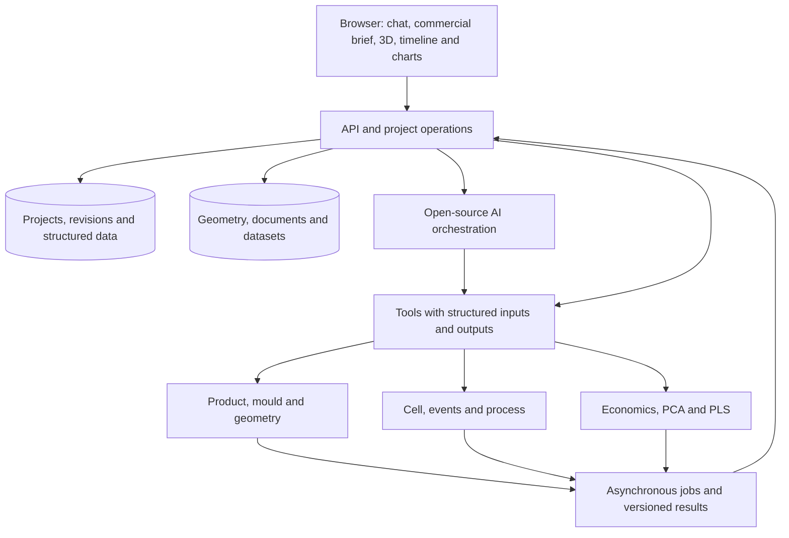

# Online platform architecture — revision 4

Updated 2026-10-16. Proposed architecture for the [specification](SPECIFICATION.md). [Implementation status](IMPLEMENTATION_STATUS.md) separates proposals from working capabilities.

## Structure

Chat and properties use the same application operations. Engines consume project snapshots; the browser replays their events/results on a shared clock. AI interprets, proposes, selects tools and explains evidence. Geometry and numerical results come from the declared engines.

## Proposed open-source stack

| Layer | Starting proposal | Responsibility |
| --- | --- | --- |
| Web application | React, TypeScript, Three.js | Customer/process experience and contextual geometry/properties |
| API/validation | Python, FastAPI, Pydantic | Generic data, operations, revisions, catalogues and results |
| Persistence | PostgreSQL and persistent file storage with metadata; object storage when needed | Briefs, conversations, original geometry, previews and datasets |
| Background jobs | Python workers and queue; RQ/Valkey as a candidate to verify | CAD import/generation, analysis, simulation and training |
| Geometry | Open CASCADE with CadQuery/FreeCAD or dedicated integration | STEP solids, supported operations, measurements and concepts |
| Simulation | SimPy candidate for events; NumPy/SciPy for reduced models | Resources, state, balances and process equations |
| Data/ML | NumPy, SciPy, scikit-learn and verified adaptation of the existing PCA library | PCA/PLS, preprocessing, validation and constrained optimisation |
| AI inference | Models selected for licence/capability; llama.cpp or vLLM according to hardware | Text, documents and vision without mandatory proprietary services |
| Distribution | Containers, HTTPS reverse proxy, persistent volumes and separate workers | Online use and reproducible local development |

These are design proposals, not installed services or benchmark results. Multimodal models, optional image generation and detailed solvers must also meet the open-source requirement. Available weights or incompatible licences do not satisfy it by implication. Hardware and hosting still have costs.

## Generic project data

Core entities: projects, revisions, briefs, requirements, products, geometry assets, material grades, mould variants, cell assets/installations, recipes, scenarios, simulation runs, datasets, analysis runs, conversations and operations.

Stable IDs and explicit references connect modules. Features are extensible typed collections: a hole, rib, cosmetic surface or electrical requirement belongs to its product. PCB, IP65, shell count and clips are not mandatory global fields.

Values have units; requirements have subject, property and condition. Sources identify customer statements, document/file evidence, assumptions or calculation methods and revisions. Original units are retained when engines convert to their own units. Commercial units/BOM, annual scenarios, lots, currency and cost bases are explicit.

Cell poses record parent frame, rigid transform and conventions. Operations record preconditions, resources, duration model and state updates. Runs reference immutable snapshots, tool versions and exact datasets/assets. Changes invalidate dependent results without rewriting historical runs. Yield and losses have one defined place in production/economic calculations.

## Operations shared by AI and properties

Each operation receives project, base revision, target, parameters/units and source. It returns applicable changes, missing inputs, performed/unavailable checks, invalidated dependencies and any job ID. Concurrent revisions require reconciliation; retries must not duplicate completed operations.

Proposed tool contracts include:

- `update_customer_brief`, `set_demand_scenario`, `add_requirement`.
- `register_geometry`, `measure_geometry`, `propose_product_change`.
- `propose_mould_variant`, `configure_cavity_layout`, `propose_cooling_circuit`.
- `configure_cell_asset`, `set_installation_pose`, `check_robot_deposit_pose`.
- `configure_process_recipe`, `run_process_scenario`, `explain_simulation_event`.
- `compare_capacity_and_cost`, `analyse_real_dataset`, `propose_constrained_trial`.

These are future contracts, not existing endpoints. Changes retain undo/scenario derivation information. Jobs have queued/running/completed/failed/cancelled states and distinguish partial results. Server events report progress; closing the browser does not implicitly delete project state.

## AI across modules

| Context | Agent role | Evidence/tools |
| --- | --- | --- |
| Customer/market | Structure requests, distinguish price/cost/unit and prioritise questions | Brief, source documents and update operations |
| Product | Interpret text/images, identify gaps and propose supported features | Original files, measurements and geometry engine |
| Mould | Propose cavities, ejection and cooling alternatives | Requirements, catalogues and available geometric/thermal checks |
| Cell | Configure layouts and explain orientation/compatibility limits | Real axes, installation frames and trajectory checks |
| Process | Build scenarios and explain parameters, dependencies and waiting | Event engine, balances and selected run log |
| Economics/data | Compare alternatives and explain predictions/trials | Cost calculations, real datasets and versioned PCA/PLS models |

Start with one coordinator and module-specific tools. Additional agent specialisation depends on measurable benefit; multiple models per request are not mandatory. Conversation does not replace structured storage. Evidence retains document/page references. Unsupported operations or unavailable AI remain visible; a local parser is not labelled as an AI agent.

## Languages

English is the repository language. Runtime UI text is localised into EN/IT/FR/ES, defaulting to English without inferring a preference from browser language. Preferences are separate from project data. Changing UI language never translates customer text, names, file contents or identifiers. Numeric/currency presentation follows the selected locale while stored numbers and unit conventions remain unchanged. Translation catalogues are an intentional multilingual-data exception to English source documentation.

## Online distribution

The product requires reachable HTTPS, persistent projects/files, project access, backups and supported execution of inference and long jobs. An initial host can run separate services; Kubernetes is not required. Mesh previews/levels of detail limit transfers of original CAD assets.

Provider, domain, users, CPU/GPU capacity and data location remain deployment decisions. They do not block local implementation and reproducible packaging. A repository or downloadable HTML does not constitute the online application. No cloud cost or response time is promised without a measured configuration.

## Migration from the demo

Reuse the viewer, mesh import, example geometry and meaningful tests. Explicit import from legacy v4 preserves fields and provenance as properties of that particular product. New projects do not inherit them.

The demo remains a local development artefact. The platform will start with a commercial home, server state and generic modules. The shell may remain an optional template/regression case, not the global data model.
