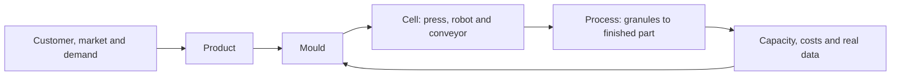

# Injection moulding feasibility and simulation platform

Updated 2026-10-16. **Customer-first, online, generic products and open-source AI across modules.** Chat and contextual properties operate on the same project.

**Current position: P0 documentation complete; P1 incomplete; a browser-AI demo experiment is implemented, with browser inference verified with self-hosted assets.** The existing demo is a local geometry/requirements experiment. [Implementation status](IMPLEMENTATION_STATUS.md) and [roadmap](ROADMAP.md) are the progress references.

| Document | Purpose |
| --- | --- |
| [Functional specification](SPECIFICATION.md) | Six modules, commercial/technical requirements and shared data |
| [User experience](UX_FLOW.md) | Main chat, contextual properties and customer-to-process workflow |
| [Simulation](SIMULATION.md) | Material, timing, kinematics, orientations and cooling |
| [Online architecture](ARCHITECTURE.md) | Services, open-source AI, versioned state and deployment |
| [Roadmap](ROADMAP.md) | Milestone status, dependencies and exit evidence |
| [Backlog and acceptance](BACKLOG.md) | Concrete work, 15 criteria and seven verification scenarios |
| [Implementation status](IMPLEMENTATION_STATUS.md) | Available capabilities and unimplemented modules |
| [Decision register](DISCOVERY.md) | Confirmed requirements and subsequent clarifications |

Repository language is English. Application languages are English, Italian, French and Spanish, defaulting to English. User-authored data remains in its original language.

The next application increment is a generic commercial brief via chat with server persistence and real open-source AI. [The local demo](../../demo/README.md) remains separate; [the enclosure](REFERENCE_CASE.md) is an optional example.
