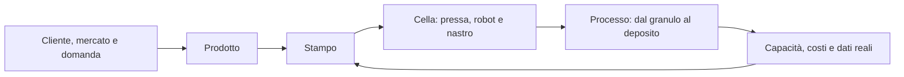

# Piattaforma di fattibilità e simulazione dello stampaggio a iniezione

Revisione 3 — 2026-10-15. **Partenza dal cliente, funzionamento online, prodotti generici e AI open source in tutti i moduli.** La conversazione raccoglie informazioni e guida operazioni condivise con le proprietà contestuali.

| Documento | Contenuto |
| --- | --- |
| [Specifica funzionale](SPECIFICATION.md) | Sei moduli, requisiti commerciali/tecnici e contratto comune |
| [Esperienza utente](UX_FLOW.md) | Chat principale, dettagli contestuali e percorso cliente → processo |
| [Simulazione](SIMULATION.md) | Materiale, tempi, cinematica, orientamenti e raffreddamenti |
| [Architettura online](ARCHITECTURE.md) | Servizi, AI open source, dati versionati e distribuzione |
| [Roadmap](ROADMAP.md) | Consegne ordinate per dipendenze e criteri di uscita |
| [Backlog e accettazione](BACKLOG.md) | Lavori concreti, 15 criteri e 7 scenari di verifica |
| [Stato reale](IMPLEMENTATION_STATUS.md) | Cosa esiste e cosa è ancora specificato |
| [Registro delle decisioni](DISCOVERY.md) | Richieste confermate e chiarimenti successivi |

Il primo sviluppo sarà il brief cliente generico via chat, con persistenza online. La prima simulazione completa collegherà alimentazione/condizionamento, pressa/stampo, robot e nastro usando tempi e modelli dichiarati, poi introdurrà i fenomeni fisici verificati.

La [demo 02](../../demo/README.md) resta una prova locale di alcune interazioni geometriche. Il [guscio elettronico](REFERENCE_CASE.md) è soltanto un caso opzionale; i progetti nuovi non ne ereditano forma, materiali o requisiti.
