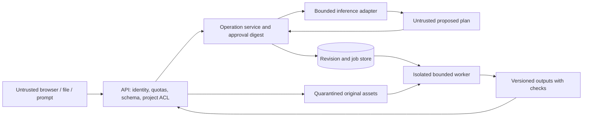

# Threat model and security gates

`AUD-2026-10-17`. Scope: existing local demo plus proposed online architecture. This is a design/review record, not a penetration test, ASVS certification or production-security claim. Controls below are marked current or planned.

## Assets, actors and trust boundaries

Assets: customer/product/commercial information; CAD and uploaded files; project memberships/revisions; approved operations; model/dataset provenance; simulation/ML/cost results; compute capacity; credentials; backups and release artefacts.

Actors include a legitimate designer/process engineer, another project member with a different role, an anonymous demo visitor, a malicious account or uploaded file/document, a compromised dependency/model host, and an operator. Accidental stale edits and misleading engineering results are hazards even without an attacker.

The proposed server is not implemented. Current browser state and its Worker share one local user's trust context; typed validation/Apply are useful controls but are not server-side authorisation. Optional Python Gemini/Claude calls are a separate external data flow, not part of the essential target workflow. No external inference calls or private data were used in this audit.

## Current protections and limits

- User/AI text and filenames are escaped on reviewed rendering paths. There is no arbitrary AI tool/shell/Python execution path in the application. This static review does not prove absence of XSS throughout future integrations.
- Structured AI updates use allowlisted groups/keys/types, positive/safe-integer quantities, explicit Apply, timestamp revision comparison and cloned/validated geometry before mutation. **The schema cannot detect a plausible but invented value in an allowed field.** Approval must remain explicit; no engineering calculation can trust model claims alone.
- Browser AI context is shortened and generation token-capped; Stop terminates its worker. There is no enforced wall-clock/total-memory inference quota or adversarial-model evaluation.
- Mesh imports have 12 MB/100,000-triangle limits and finite coordinate checks; triangle limits run after loader allocation. Parsing is in the browser main thread. Images have byte/pixel checks, but decoding occurs before the pixel-count rejection.
- Original mesh/photo bytes and conversations are not durably managed. Browser storage is not a multiuser security boundary, encrypted vault or backup service.
- Development HTTP servers are loopback tools, not secured public application servers. Test Chromium uses `--no-sandbox` in an isolated test environment; those flags are not a production browser hardening configuration.

## Findings and required tests

| ID / priority | Threat or failure | Present evidence | Required control and acceptance test |
| --- | --- | --- | --- |
| T01 / release blocker | Cross-project access through guessed IDs, asset/run/job references or copilot context | No API/ACL exists | Authenticate principal; authorise every project/object lookup; verify foreign-project and mixed-reference requests fail without leakage |
| T02 / release blocker | Model changes tool/name/target/parameters after review; excess agency | Current narrow Apply is local, no approval digest | Exact typed registry, no arbitrary code, server-computed effects/digest, principal/project/revision-bound single-use approval and idempotency; altered/stale/replayed approval must fail |
| T03 / high | Prompt injection through RFQ text, CAD metadata, documents or model output | No evidence that prompt instructions alone are reliable; structured errors observed historically | Treat sources as data, minimise context, keep secrets outside prompts, allowlist tools/scopes and validate all outputs; hostile text cannot gain permissions or auto-run jobs |
| T04 / release blocker | Lost updates, duplicate operation/job or inconsistent results after retry/crash | Timestamp guard and one browser object | Monotonic revisions/transactional compare-and-swap, operation/job idempotency, leases and immutable input manifests; concurrent edits and crash/retry tests |
| T05 / high | HTML/Markdown/filename injection in chat, properties, report or scientific label | Escaped current paths, no dedicated XSS suite | Text-safe rendering/sanitisation where rich text is allowed, restrictive CSP without unsafe eval, output download policy; malicious strings must remain inert in all languages/views |
| T06 / release blocker | Malformed STEP/STL/OBJ/PDF/image, decompression/memory/CPU exhaustion | Main-thread loaders; no isolated CAD/doc parser | Quarantine, format sniffing/limits, network-disabled bounded parser worker, no macros/unsafe serialisation; oversized/malformed/time-limit/cancellation tests with no host access |
| T07 / release blocker | Public unbounded inference/simulation, excessive parts/events or repeated jobs | Manual Stop; no server quotas | Per-principal/project/global size/token/concurrency/event/horizon/time/memory budgets, rate limiting/backpressure and cancellation; no anonymous privileged compute endpoint |
| T08 / high | Dependency/model asset compromise or unsafe native processing | Six npm audit dependency entries; model/runtime files fetched from hosts | Pin/integrity/licence manifests, model hash checks, dependency advisory/reachability review and isolated execution; compromised/modified asset must be rejected where integrity is enforced |
| T09 / high | CSRF, permissive CORS, stolen browser tokens or insecure session | Online sessions absent | Same-origin design, HttpOnly/Secure/SameSite sessions, CSRF/origin checks, explicit CORS, OIDC validation and session expiry/revocation tests |
| T10 / high | SQL/command/path injection or unsafe deserialisation in future jobs | Current app has no SQL/job API; Python source does not supply a guarded backend | ORM/parameterised queries, no shell interpolation/eval/generated code, project-scoped blob IDs, no untrusted pickle; injection/path traversal tests |
| T11 / high | Private data in model requests, logs, reports, caches or backups | Local/browser and optional external Python paths differ | Default local/self-hosted inference; approved external routes only, no raw secrets/full prompts in operational logs; redaction, access and retention/deletion tests |
| T12 / release blocker | Plausible engineering output with missing inputs, wrong units, stale model or known PCA errors | T²/Q scale and all-missing defects reproduced | Unit/source checks, unknown/incomplete/stale states, model-specific validity gates and independent references; zero must not mean missing/healthy |
| T13 / high | Missing backups, broken migrations or silent partial asset write | No server persistence/restore implementation | Transactional asset manifests, migrated revisions, versioned backup/restore and deletion lifecycle tests |
| T14 / later capability gate | Retrieval/vector poisoning or embedding leakage | No RAG/vector store implemented | Add source admission, retrieval ACLs, provenance and poisoning tests before enabling retrieval; do not claim current RAG protection |

No known finding is waived by the fact that components are open source. Scope/reachability analysis distinguishes installed code from an actually exposed path; it does not automatically dismiss a high-severity advisory.

## Dependency advisory evidence

`npm audit --json` executed on 17 October 2026 and exited 1. It reports **six affected dependency entries: two high and four moderate**; inherited entries include `@huggingface/transformers`, `onnxruntime-node`, `global-agent` and `roarr`.

Primary advisory reports observed:

- `sharp` <0.35.0: [GHSA-f88m-g3jw-g9cj](https://github.com/advisories/GHSA-f88m-g3jw-g9cj), reported inherited libvips vulnerabilities.
- `sharp` <0.35.4: [GHSA-rgj7-g3m4-5g8c](https://github.com/advisories/GHSA-rgj7-g3m4-5g8c), reported libheif issues.
- `sharp` <0.35.5: [GHSA-wq5f-xc86-pv6w](https://github.com/advisories/GHSA-wq5f-xc86-pv6w), reported librsvg issue.
- `sprintf-js` ≤1.1.3: [GHSA-hp3w-g68c-fv3c](https://github.com/advisories/GHSA-hp3w-g68c-fv3c), reported unbounded-precision denial of service.

These are registry advisory findings, not reproduced exploits. The current browser worker imports the web distribution; there is no sharp-based uploaded-image backend. Exact bundle/native reachability remains to be assessed. Do not claim either that all six entries are reachable browser flaws or that the release is safe. I00 remediation/triage must precede online/native input exposure; no `npm audit fix` or lockfile change is made during this audit. Python CVE scanning was not run (`pip-audit` absent); `pip check` is not a vulnerability scan.

## AI operation security contract

Identity is derived server-side. Authorisation precedes context assembly, preview and execution. Disallow arbitrary URLs/paths/scripts in tool arguments. A preview states changed and invalidated objects, units, missing evidence, job costs/budgets and unsupported checks. The approval digest covers canonical effects, tool/version, project/head revision and source references, with expiry and replay protection. A new numerical/geometric result does not gain permission to modify its inputs.

Undo creates a new compensating revision. Concurrent edits cannot be erased; stale plans need reconciliation and new review. Long jobs are bound to immutable snapshots, with input/output/engine hashes and explicit partial/stale results. Tool output text is never executed. The AI does not select an identity, waive a failed check, invent an axis/material property or mark a result verified.

## Demo, private mode and operational controls

An anonymous public demo can run browser-only synthetic cases without private API/job access. Any anonymous server demo capability must have its own scoped session, isolated state and strict quotas before exposure; it is not a shortcut into private endpoints. An interim unauthenticated developer service is explicitly loopback-only and cannot be enabled for public/private-user hosting by changing a bind address unnoticed.

Define configuration keys for maximum upload bytes/decompressed data/triangles, parser timeout/RSS, model context/tokens, simulation horizon/events/part instances, active jobs and request rate. Derive release values from benchmarks on the selected host; documented illustrative limits are not production measurements. Exceeding a budget returns a clear bounded error and retains the project. Admin-controlled safe resource limits are not artificial paid feature locks.

Secrets stay in the server/runtime secret store, not repository/exports/browser prompts. Logs record IDs, status, timing and hashes with necessary redaction; original project conversations belong to access-controlled project data, not general logs. Define configurable retention and deletion across source assets, derived outputs, models/caches and backup expiry. Record operators, restore tests and incident procedure. No GDPR/legal or production-security guarantee is asserted.

## OWASP mapping and assurance

ASVS **5.0.0** official tagged documentation was inspected. Target online/private controls should be traced to relevant ASVS requirements (identity/session, authorisation, input/output, files, configuration, data protection and business logic), with an L2 assessment as a proposed release target. No ASVS level has been achieved or certified.

The active OWASP source identifies **GenAI LLM Top 10 2026**, released 4 August 2026. Use that edition's ordering: LLM01 prompt injection (T03), LLM02 sensitive disclosure (T11), LLM03 excessive agency (T02), LLM04 supply chain (T08), LLM05 data/model poisoning (data admission), LLM06 unbounded consumption (T06/T07), LLM07 misinformation (T12), LLM08 hidden-context exposure (T11), LLM09 vector/embedding weaknesses (T14), LLM10 improper output handling (T05/T10). These are review mappings, not evidence that the complete standard was tested. Sources/licences: [research provenance](../compliance/RESEARCH_PROVENANCE.md).

## Release gates

Before private/public online use: close or explicitly approve documented exceptions for dependency findings; authenticate/authorise project/assets/jobs; prove cross-project isolation; bound untrusted parsing/inference/simulation; verify CSRF/CORS/CSP and output handling; test backups/migrations; validate permitted engine/data/model versions and scientific checks; conduct independent application-security review. Existing 28 unit checks and browser smokes do not satisfy these gates. The reporting policy is [SECURITY.md](../../SECURITY.md).
