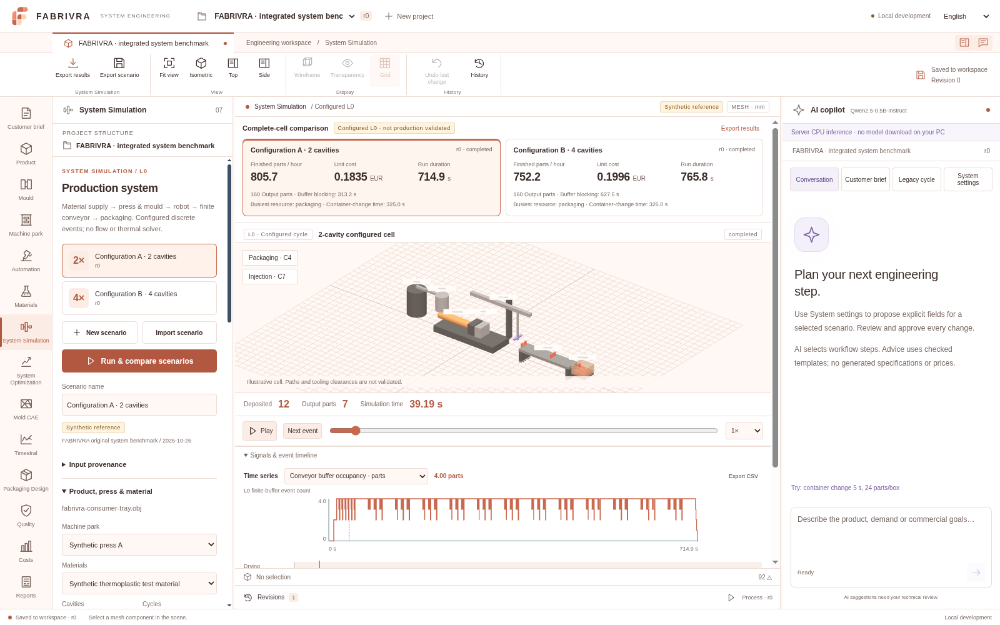
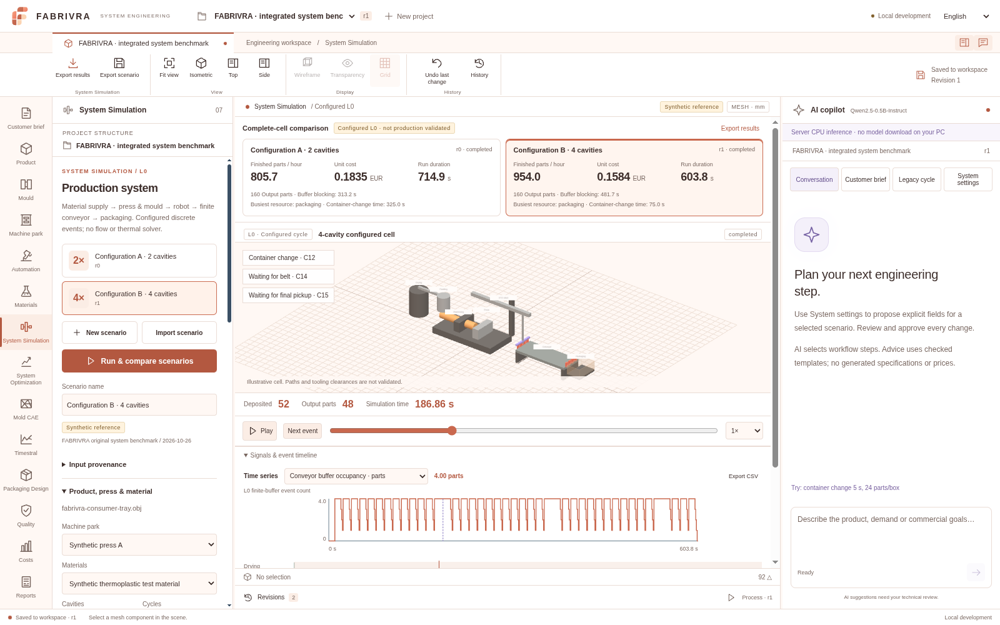

# FABRIVRA V2 — implemented and verified increment

26 October 2026. [Scope/roadmap](../product/FABRIVRA_V2.md) · [Engine/contracts](../architecture/SYSTEM_SIMULATION.md) · [Browser instructions](../deployment/CODESPACES.md).

## Continuity and selected source

Published `trial/codespaces-process` at **dd1f5b883acd4e00a1e2eb8b48b9c809242d9fbd** was confirmed as the most advanced published trial before coding. The supplied runner had dirty/untracked earlier work, including an unpublished mould/STEP/FEM experiment, while checked out on the older demo branch. It was preserved in local `archive/pre-v2-experiment-2026-10-26` (**0c2c00c45046f1d65919bb02197e67009308e029**), a retained stash and a verified private Git bundle outside the checkout before switching. Private online SQLite backup, integrity and restoration/asset checks were completed. The runner database had zero customer project rows; data in an inaccessible external Codespace was not inspected or changed.

Implementation uses `feature/fabrivra-v2-system-simulation` descended from the published trial. No `main` merge, branch deletion, force-push or repository rename is performed. MIT, existing data/history/tests and private credentials are retained. The unreviewed mesh/FEM experiment and GPL-related dependencies are not integrated into the V2 runtime/source locks. New numerical engine code is standard-library-only.

All V2 package texts, simulator specification, acceptance tests, repository state and three reference images were read before source changes; all 12 manifest file hashes matched. KPI values from the reference image were not copied as scientific data. Current screenshots below show actual computed fixture output.

## Demonstrated complete-cell value

Each row is a **configured synthetic 160-part campaign**, including startup and drain. Equipment, material properties, times, costs and geometry are original declared fixtures, not verified OEM/grade/production data.

| Case | Cavities | Campaign s | Finished parts/h | Configured EUR/part |
|---|---:|---:|---:|---:|
| Four-slot conveyor, 12 parts/box, 25 s change | 2 | 714.890000 | 805.718362 | 0.183540 |
| Same downstream constraints | 4 | 765.756667 | 752.197173 | 0.199605 |
| Change only four-cavity box capacity to 48 | 4 | 603.756667 | 954.026733 | 0.158355 |
| Fast-downstream counterexample, both configurations | 2 | 485.710000 | 1185.892817 | 0.151710 |
| Same fast-downstream counterexample | 4 | 257.376667 | 2237.965110 | 0.128997 |

Fast downstream means 1000 slots, zero box-change time and 0.01 s/part handling, explicitly configured for this counterexample. It is not a real packaging design recommendation. The ordinary baseline has 13 box changes/325 s in each campaign; finite-belt capacity blocking is approximately 313.2 s versus 627.5 s. Greater cavitation loses in that case and wins after downstream changes; the conclusion is derived from events, not hardcoded. Slowing press injection capacity or changing EOAT trip capacity independently changes timing/output in tests. Busy-time “bottleneck” ranking is labelled a heuristic.

Reproduce without touching user data:

```sh
.venv-app/bin/python scripts/reproduce_system_benchmark.py
```

[Machine-readable reproduction](FABRIVRA_V2_BENCHMARK_2026-10-26.json) records physical schedule hashes independent of randomly assigned project/resource IDs. [Importable kit](../../examples/system-benchmark) and `/api/system/example-kit` contain the original OBJ, CSVs, two scenario JSONs, README and file hashes. Separate-project benchmark creation/import never overwrites existing projects.

## Executed checks

| Command/check | Actual outcome |
|---|---|
| Baseline before edits: backend, prototype, build, real browser/AI/engineering, launcher | 28 backend + 28 prototype passed; build/browser/launcher passed |
| `python scripts/setup_codespaces.py --with-ai` | Passed actual hash-locked setup, lockfile installs, build and prepared cached compact model verification. No new model/profile selected |
| `PYTHONPATH=server .venv-app/bin/python -m unittest discover -s server/tests -v` | **42 tests passed**, including 50 typed extraction/refusal subcases; no baseline test removed |
| `npm --prefix prototype test` | **28 tests passed** |
| `npm --prefix web run build` | TypeScript + production build passed; final JS approximately 1.067 MB / 303 kB gzip; existing large-chunk warning remains |
| `npm --prefix web run test:browser -- --server-ai --engineering` | Passed actual Chromium/API/WebGL legacy projects, imports, units, preview/approval/undo, persistence/restart, machine/material library, native AI, linked layout/traces and four languages/mobile; zero uncaught browser exceptions |
| `node web/tests/system-workflow.mjs --server-ai` | Passed actual complete-cell comparison, packaging intervention/animation, stale dependencies, old run immutability, native system proposal/approval/undo, portable browser JSON restore, actual API restart, explicit reopen, four languages and mobile; zero uncaught exceptions |
| `.venv-app/bin/python scripts/test_codespaces.py` | Passed real launcher with synthetic Codespaces variables: exact/re-written origin, owner login/CSRF, actual CPU model, legacy run, new system comparison, backup/restore, safe restart and logout. **Not external GitHub forwarding** |
| `.venv-app/bin/python scripts/evaluate_system_assistant.py` | **45/50 native cases; strict quality gate fails intentionally**. 19/24 supported extractions, 26/26 refusals after typed validation. No malformed proposal applied |
| `python scripts/backup_workspace.py` | Verified private SQLite online backup/integrity; original database and credentials retained |
| `git diff --check`, `.venv-app/bin/python -m pip check`, Git bundle verification | Passed. Source dependency lockfiles unchanged; installed development extras from the preserved old experiment are not declared V2 runtime requirements |

Browser regression waits explicitly for readiness after approval and explicitly reopens saved projects after reload, reflecting the new empty-start policy. Original assertions remain. No failing engineering assertion was disabled.

Tests independently check every event-boundary mass sum/non-negativity, conveyor occupancy ≤ capacity, exclusive resource intervals, whole-shot material starvation, plasticising/cooling overlap, final-grip clearance, orientation/payload/pitch/declared reach statuses, finite boxes, a hand-calculated single-shot oracle, exact/missing cost semantics, invalidation boundaries and foreign-project access. Contract tests verify consistent port units, non-converged CAE rejection and forecast interval alignment. This verifies implemented software, not experimental polymer/production validation.

Browser checks exposed and fixed two real issues: range-step rounding could stop fractionally before the final part event (slider now allows the exact run endpoint); browser JSON numeric normalisation initially broke backup hashes (typed semantic canonicalisation and a regression now preserve integrity without changing exact money strings). A concurrent regression run also exposed a test acting before a disabled Run control became ready; it now waits for that actual readiness condition, retaining the numerical oracle.

## Actual UI evidence





[Mobile render](../design/FABRIVRA_V2_MOBILE_2026-10-26.png) · [Browser numerical outcomes](FABRIVRA_V2_BROWSER_2026-10-26.json). Images are test-run captures, not availability of a live external service.

The original modular-F SVG mark/wordmark/mono/dark/favicon variants are in `web/public/brand`; light palette is centralised in `tokens.css`. Module navigation occurs once in the left rail. The persistent geometry canvas/camera/selection and copilot draft survive switches; process-specific visualization samples stored runs. Signals/timeline and evidence can collapse, and right properties/copilot panels resize/hide. UI defaults to English with Italian/French/Spanish choices; private project contents are not translated or overwritten.

## AI quality, memory and costs

The same pinned compact q4 file/revision is used; no new weights, GPU or paid API. Fifty actual native-model generations were executed, not mocked. [Full outputs/failures](FABRIVRA_V2_AI_2026-10-26.json) show 45 correct cases: five unsupported/missing-shape or misspelled-key outputs were rejected safely. The scope is bounded L0 extraction/refusal, **not** the full future CAD/engineering competence benchmark. Median per-case generation was 2.0065 s with the model already loaded in that evaluation; total generation was 111.657 s. Server requests additionally load/checksum the model and are slower.

A separate actual native process including load/checksum took **9.785 s** and Linux child wait/rusage measured **3,010,032 KiB (~2.87 GiB) peak RSS** on this runner. [Raw measurement](FABRIVRA_V2_MODEL_RESOURCES_2026-10-26.json). API `/proc` sampling observed only the API (~71 MiB), so that smaller figure is **not** reported as native-model memory. The external two-core Codespace hardware/performance is unmeasured. Concurrent runner checks can affect latency. An existing optional larger-model cache is retained from prior work; it is not downloaded/promoted by V2 or a fresh compact-only installation requirement.

No hosting resource, GPU, paid API, billing configuration or Codespace was activated. Current GitHub account allowance/storage pricing was not verified; Codespaces use can still consume quota/cost money. Closing a browser does not stop compute. Private data/model caches never enter Git.

## Blocked, partial and absent

- **External runtime:** current authenticated Codespaces API returns HTTP 200 with zero instances. New source/runner checks do not prove an externally reachable/private forwarded browser service or update somebody else's instance. The owner must update/open their Codespace using the guide.
- **Official ChatGPT-plan integration:** eligibility unverified; official source fetches were blocked by the egress proxy (tunnel 403). No OAuth/client/callback/token/API billing invented. Existing free CPU provider retained. [Evidence/next conditions](../deployment/AI_CODESPACES_ELIGIBILITY.md).
- **Physics/geometry:** mould copies/plates, declared travel and generic XYZ motion are preliminary. Pressure/temperature/moisture/torque, actual collision/EOAT/container fit, thermal energy model, detailed mould/cooling construction and product acceptance are unavailable/unverified. Annual projections assume identical configured campaigns/100% acceptance.
- **Specialist modules:** Mold CAE output contract, future probabilistic forecasting output contract and explicit module screens only. No mesh/FEM/FVM, Timestral weights/forecasts, Packaging Design CAD, FMI execution or trusted integrated PCA/PLS. No GPL/AGPL/Modified-MIT solver/weights adopted.
- **Repository:** rename to `MarDan93/fabrivra` is [prepared](../deployment/REPOSITORY_RENAME.md), not executed. Source publication does not rename the repository or activate a hosted service.

Reusable Codex setup/start/network instructions are saved separately as a reviewable environment draft. Review/Save and Publish activate that configuration; saving does not apply it or prove fresh-task restoration. App use in a Codespace follows its existing `.devcontainer` scripts independently.
